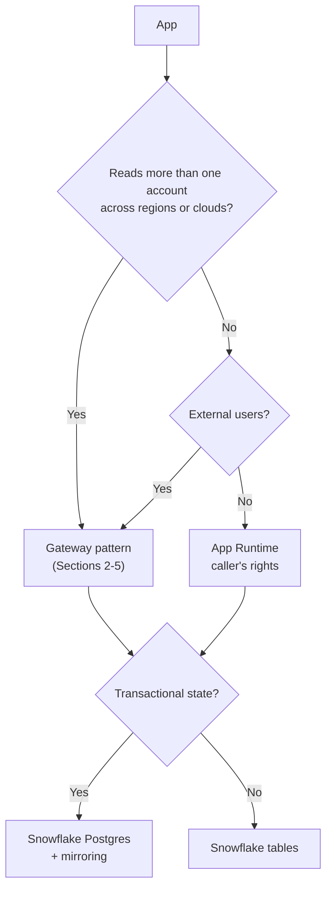

   

# Decide in the Gateway, Enforce in Snowflake: Identity-Aware Access for Custom Apps

A best-practices guide for teams whose internal apps, client portals, or AI agents reach Snowflake through a shared gateway. It shows how to move access enforcement out of app code and into Snowflake, so every query runs as an identity Snowflake can see, govern, and audit.

Pair-programmed by SE Community + Cortex Code

**Created:** 2026-11-19 | **Last verified:** 2026-11-19 | **Expires:** 2027-01-18 | **Status:** ACTIVE

**Audience:** Platform, security, and app engineers whose internal apps, portals, or agents query Snowflake through a shared gateway

> **No support provided.** Reference only; validate before production use.

---

## Quick Start

1. Inventory every identity your gateway uses to reach Snowflake. If one service identity can read everything, start here.
2. Give each principal its own identity: External OAuth for people, one workload-identity service user per app, and agent sessions flagged as agentic.
3. Write entitlements down once, as code (principal, client, data source, read or read-write, account), and generate roles and grants from that file.
4. Enforce client isolation in Snowflake with row access policies keyed on the real caller, then audit with `ACCESS_HISTORY`.
5. Shrink the gateway to routing, caching under entitlement-scoped keys, and token handling.

**See it assembled:** The [worked example](WORKED-EXAMPLE.md) takes one synthetic reporting app through an entitlement catalog, a client-isolation policy, entitlement-scoped cache keys, and a least-privilege report, each with fixture-backed checks.

## The Mental Model

> Snowflake can only enforce access for identities it can see, so pass the real caller through, and let the gateway route instead of filter.

A common first architecture puts a gateway in front of Snowflake. The gateway connects with one broad service identity, runs the query, and filters the results in application code before returning them. That works until it doesn't. A filter is a decision, and enforcement is a guarantee: a bug, a missed code path, or a prompt-injected agent bypasses the filter and sees everything the service identity can read.

Every practice in this guide serves three goals:

1. **Make the caller visible:** each query runs as the person, app, or agent that asked.
2. **Define access once:** one entitlement source compiles to grants in every account.
3. **Enforce where the data lives:** Snowflake policies decide which rows and columns come back, and Snowflake logs who saw what.

The gateway still has a job. It decides *where* a request goes and *which role* it should use. It stops being the only thing standing between a caller and every client's data.

---

## 1. A Filter Is Not Enforcement

When results are filtered in app code, the gateway's service identity is the real security boundary, and Snowflake cannot help you defend it. Row access policies, masking policies, and access history all evaluate the session's user and role. If every session is the same service user, every policy sees the same caller.

### Recognize the shared-identity anti-pattern

Signs you have it:

- One service user (key pair or workload identity) connects for every app and every person
- Access rules live in a custom permission service and are applied after the query returns
- `ACCESS_HISTORY` shows one user name for queries made on behalf of hundreds of people
- Apps get broad grants because scoping each app by hand is too slow

### Separate deciding from enforcing

| Responsibility | Belongs in | Why |
| --- | --- | --- |
| Which account and role a request should use | Gateway | It sees the request context and the account topology |
| Whether a row or column may be returned | Snowflake policies | Enforced on every query path, including ones the gateway never anticipated |
| Who accessed what, and when | Snowflake `ACCESS_HISTORY` | Recorded per user, independent of app logging |
| What each principal is entitled to | Entitlement catalog (code) | One reviewable source compiled into both of the above |

### Ask the blast-radius questions

For each identity the gateway uses: what can it read, in how many accounts, and what happens if its credential or its container is compromised? If the answer is "every client," fix identity before anything else.

### Summary of practices

| Practice | Why it matters |
| --- | --- |
| Inventory gateway identities | You cannot scope what you have not counted |
| Treat app-code filters as decisions, not controls | Filters fail open on bugs and prompt injection |
| Put enforcement in Snowflake policies | Policies apply on every query path |

---

## 2. Propagate the Real Identity

Policies and audit can only key off the identity on the session. Each kind of principal needs its own way to arrive in Snowflake as itself.

### People: External OAuth with role scopes

Configure a [custom External OAuth security integration](https://docs.snowflake.com/en/user-guide/oauth-ext-custom) for your authorization server. Tokens must carry `iss`, `aud`, `exp`, `iat`, and a scope claim (`scp` or `scope`). A scope of `session:role:<ROLE>` sets the session's primary role, so the gateway requests a token for the person in an approved role instead of connecting as itself. See [CREATE SECURITY INTEGRATION (External OAuth)](https://docs.snowflake.com/en/sql-reference/sql/create-security-integration-oauth-external).

- Map tokens to users with `EXTERNAL_OAUTH_TOKEN_USER_MAPPING_CLAIM` and `EXTERNAL_OAUTH_SNOWFLAKE_USER_MAPPING_ATTRIBUTE` (`LOGIN_NAME` or `EMAIL_ADDRESS`). Values must match exactly.
- Leave `EXTERNAL_OAUTH_ANY_ROLE_MODE = DISABLE` unless you have a reviewed reason. Privileged roles such as ACCOUNTADMIN and SECURITYADMIN are blocked by default.
- If your authorization server emits space-delimited scopes, check `EXTERNAL_OAUTH_SCOPE_DELIMITER`. The default is a comma, and the docs state that Snowflake Support must enable this property. Spike token compatibility before you design around it.

### Apps: one service user per app, no stored secret

Give every app its own `TYPE = SERVICE` user authenticated with [workload identity federation](https://docs.snowflake.com/en/user-guide/workload-identity-federation) (GA). On AWS the user trusts the app's IAM role, so there is no key pair to store or rotate. Grant each app only the access roles it needs. A compromised app then exposes one app's scope, not the gateway's.

```sql
CREATE USER svc_reporting_app TYPE = SERVICE
  WORKLOAD_IDENTITY = (TYPE = AWS ARN = 'arn:aws:iam::<account>:role/<app_role>')
  DEFAULT_ROLE = reporting_app_role;
```

### Agents: flag the session as agentic

Create a separate External OAuth integration for agent traffic with `IS_AGENTIC = TRUE`. Agent sessions then return TRUE for `SYS_CONTEXT('SNOWFLAKE$CURRENT', 'IS_AGENT_ACTIVATED')`, which policies can use, and agent activity is visible in `QUERY_HISTORY.agent_type` and `ACCESS_HISTORY.agents_info`. See [agent identity](https://docs.snowflake.com/en/user-guide/agent-identity). `LOGIN_HISTORY` and `SESSIONS` do not carry an agent column, so audit agents from the query and access views.

### Many accounts: organization users

Hand-creating the same person in every account does not scale. [Organization users and organization user groups](https://docs.snowflake.com/en/user-guide/organization-users) (GA, Enterprise Edition) let you create a person or service once in the organization account and import groups into each account. Importing a group creates a role of the same name. Authentication is still configured per account.

### Summary of practices

| Practice | Why it matters |
| --- | --- |
| External OAuth with `session:role:` scopes for people | Each session runs as the person, in an approved role |
| One workload-identity service user per app | Removes stored secrets and shrinks blast radius |
| `IS_AGENTIC = TRUE` integration for agents | Agent sessions are distinguishable in policy and audit |
| Organization users and groups | Define each identity once across accounts |
| Spike token claims and scope delimiters first | Token incompatibility blocks everything downstream |

**Further reading**:

- [Configure a custom authorization server for External OAuth](https://docs.snowflake.com/en/user-guide/oauth-ext-custom)
- [Workload identity federation](https://docs.snowflake.com/en/user-guide/workload-identity-federation)
- [Agent identity](https://docs.snowflake.com/en/user-guide/agent-identity)

---

## 3. Entitlements as Code

Grants made by hand in each account drift. Developers create schemas, roles follow later, and broad grants fill the gap. A single entitlement source fixes this, because every grant becomes the output of a reviewed change.

### Keep one entitlement catalog

Store entitlements in git as data: principal, client, data source, read or read-write, account, plus the data class that drives isolation (for example, contractually separated client data vs. general reference data). An access-request UI should open a pull request against this file, not change grants directly. The [worked example](WORKED-EXAMPLE.md#3-configure-the-entitlement-catalog-and-snowflake-objects) shows a complete catalog.

### Give every schema a reader and writer database role

Create a `<SCHEMA>_R` and `<SCHEMA>_RW` [database role](https://docs.snowflake.com/en/sql-reference/sql/grant-privilege) per schema, with future grants so new tables are covered automatically. Team roles bundle access roles; per-principal grants cover exceptions.

```sql
CREATE DATABASE ROLE reporting_db.reporting_r;
GRANT USAGE ON SCHEMA reporting_db.reporting TO DATABASE ROLE reporting_db.reporting_r;
GRANT SELECT ON FUTURE TABLES IN SCHEMA reporting_db.reporting TO DATABASE ROLE reporting_db.reporting_r;
GRANT DATABASE ROLE reporting_db.reporting_r TO ROLE delivery_team;
```

Database roles only cover objects in their own database. Schema-level future grants take precedence over database-level ones for the same object type, and future grants do not fire on table rename or swap.

### Apply the catalog with Terraform

The [Snowflake Terraform provider](https://docs.snowflake.com/en/user-guide/terraform) (source `snowflakedb/snowflake`; Snowflake supports version 2.0.0 and later) can apply roles and grants to every account from the same catalog. At the time of writing the provider has no organization-user resource, so plan to manage organization users and groups with SQL or another automation path.

### Summary of practices

| Practice | Why it matters |
| --- | --- |
| One git-backed entitlement catalog | One reviewable source for every grant |
| Access requests open pull requests | Changes are reviewed and reversible |
| `_R` / `_RW` database roles per schema with future grants | New tables inherit the right access automatically |
| Terraform applies the catalog to every account | Removes per-account drift |
| Verify provider coverage per object type | Not every object type has a resource |

---

## 4. Enforce and Prove It in Snowflake

Once the session carries the real caller, Snowflake can enforce isolation and record evidence on every query path.

### Isolate clients with row access policies

A [row access policy](https://docs.snowflake.com/en/user-guide/security-row-using) returns BOOLEAN per row. Drive it from a mapping table generated by the entitlement catalog, keyed on `CURRENT_USER()` for per-person entitlements or `IS_ROLE_IN_SESSION()` for role-based ones. Snowflake recommends memoizable functions instead of mapping-table subqueries for performance. Row access policies require Enterprise Edition.

```sql
CREATE ROW ACCESS POLICY governance.policies.client_isolation
AS (row_client_id VARCHAR) RETURNS BOOLEAN ->
  EXISTS (SELECT 1 FROM governance.entitlements.client_entitlements e
          WHERE e.principal = CURRENT_USER() AND e.client_id = row_client_id);
```

Give the policy argument a name that differs from the mapping table's columns. Otherwise the unqualified name resolves to the table column and the comparison is always true. `CURRENT_USER()` and `CURRENT_ROLE()` reflect the session, while `INVOKER_ROLE()` reflects the executing context (a view owner, an owner's-rights procedure, a task owner). A policy can only see the end user if the session runs as that user, which is why Section 2 comes first.

### Mask sensitive columns the same way

[Masking policies](https://docs.snowflake.com/en/user-guide/security-column-intro) are column-level and evaluate the same session context. Row access policies are evaluated before masking. One column cannot appear in both a masking policy and a row access policy signature.

### Test the empty paths

A user with no entitlements should get zero rows, and the app should say "you have no clients assigned," not "no data." Test inaccessible, policy-filtered, and genuinely empty results separately so the app (or an agent) never invents an explanation.

### Audit per user and report least privilege

[`ACCESS_HISTORY`](https://docs.snowflake.com/en/sql-reference/account-usage/access_history) (Enterprise Edition, up to 3 hours latency) records the user and the objects each query touched. It has no role column, so join to `QUERY_HISTORY` on `query_id` for the role. Compare that usage with [`GRANTS_TO_ROLES`](https://docs.snowflake.com/en/sql-reference/account-usage/grants_to_roles) (up to 2 hours latency) to find grants unused for 90 days and feed them back into the catalog as revocation candidates. Treat results as candidates for review: a grant used only through role inheritance or a secondary role may not match directly.

### Summary of practices

| Practice | Why it matters |
| --- | --- |
| Row access policies from a generated mapping table | Client isolation enforced on every query |
| Memoizable functions for policy lookups | Keeps policy evaluation fast |
| Masking policies on sensitive columns | Column protection follows the caller |
| Separate zero-row, no-access, and empty tests | Prevents misleading answers |
| Least-privilege report from access and grant history | Over-provisioning becomes visible and reversible |

**Further reading**:

- [Understanding row access policies](https://docs.snowflake.com/en/user-guide/security-row-intro)
- [ACCESS_HISTORY view](https://docs.snowflake.com/en/sql-reference/account-usage/access_history)
- [GRANTS_TO_USERS view](https://docs.snowflake.com/en/sql-reference/account-usage/grants_to_users)

---

## 5. What the Gateway Still Does

Moving enforcement into Snowflake does not remove the gateway. It narrows it to work only the gateway can do.

### Route across accounts

When data lives in several accounts across regions or clouds, the gateway picks the target account and role from the entitlement catalog. Within one region, zero-copy sharing can reduce how many accounts a request touches; across regions and clouds, routing avoids copying data.

### Key the cache by entitlement scope

A results cache keyed only on query text can serve one client's data to another client's user. Key every cache entry on the query **and** the caller's entitlement scope (for example, a hash of the sorted client list). Users with identical scope can safely share an entry; users with different scope never do. Set TTLs per data class.

### Handle tokens, not data decisions

The gateway exchanges and forwards tokens, enforces rate limits, and logs requests. It should not hold a credential that can read more than the caller can.

### Summary of practices

| Practice | Why it matters |
| --- | --- |
| Route by account and role from the catalog | Gateway decisions come from the same source as grants |
| Cache key = query + entitlement scope | Prevents cross-client cache leaks |
| Forward the caller's token, not a shared credential | Keeps Snowflake the enforcement point |

---

## 6. Optional: Snowflake-Native Hosting for Internal Apps

For internal apps whose users are already Snowflake users, hosting the app in Snowflake removes the gateway hop and app secrets entirely. External-facing portals and apps that span accounts stay behind the gateway pattern above.

### Run internal apps on App Runtime with caller's rights

[Snowflake App Runtime](https://docs.snowflake.com/en/developer-guide/snowflake-app-runtime/about-snowflake-app-runtime) deploys an app as an `APPLICATION SERVICE` (managed compute GA). With [caller's rights](https://docs.snowflake.com/en/developer-guide/snowflake-app-runtime/access-control), queries run as the signed-in user with that user's **default role**, bounded by the caller grants (`GRANT CALLER ...`) on the app's execution role. With no caller grants, the app cannot act on the caller's data at all. Because queries run as the user, the row access and masking policies from Section 4 apply without auth code in the app.

- Users sign in as Snowflake identities, so generate each person's default role from the catalog, and keep external clients on the gateway.
- Grant `USAGE ON APPLICATION SERVICE` to roles, plus USAGE on its database and schema. Manage those grants in the catalog too.
- Outbound calls need [external access integrations](https://docs.snowflake.com/en/developer-guide/snowflake-app-runtime/security). Treat them as catalog-managed objects.
- Deploy each app in the account that holds its data, and route anything that spans accounts through the gateway.
- **Serverless compute is Preview**: fixed 2 vCPU / 4 GiB, a single instance, and local state lost on stop. Python apps are Preview and serverless-only; Node.js is GA on managed compute. See [serverless compute](https://docs.snowflake.com/en/developer-guide/snowflake-app-runtime/serverless).
- **Cost:** managed compute bills while nodes run, under the account-level `SNOWFLAKE_APP_RUNTIME` service type (not per app); serverless bills per app only while running.

### Keep app state in Snowflake Postgres, mirrored for analytics

- **Limits:** an instance allows at most [32 databases and 64 roles](https://docs.snowflake.com/en/user-guide/snowflake-postgres/postgres-roles), so do not create a database or role per client. Use a few roles per app tier and Postgres row-level security by client.
- **Authentication:** [instance authentication](https://docs.snowflake.com/en/user-guide/snowflake-postgres/postgres-authentication) can be `POSTGRES`, `POSTGRES_OR_SNOWFLAKE` (token auth), or `EXTERNAL_OAUTH` (GA). Postgres access roles for token auth are **Preview**; tokens last 15 minutes. After a revoke, an issued token can still open new connections for up to 15 minutes, and open connections stay open, so terminate sessions for urgent revocations.
- **Network:** instances accept no inbound connections until you attach a [network policy with `POSTGRES_INGRESS` rules](https://docs.snowflake.com/en/user-guide/snowflake-postgres/postgres-network), Private Link, or VPC peering.
- **Always on:** suspend and resume are [manual](https://docs.snowflake.com/en/user-guide/snowflake-postgres/managing-instances), and resume takes minutes. Budget for an always-on instance.
- **Mirroring (GA):** [mirroring](https://docs.snowflake.com/en/user-guide/snowflake-postgres/postgres-data-mirroring) lands Postgres tables as native Snowflake tables, which then inherit Snowflake policies and audit. It runs within one account only (no cross-account, region, or cloud), on AWS and Azure, and not on the BURSTABLE tier. **Require primary keys:** a table without one mirrors inserts only, and the source then rejects UPDATE and DELETE on it.

### Decide where each app runs



### Summary of practices

| Practice | Why it matters |
| --- | --- |
| App Runtime with caller's rights for internal apps | Per-user enforcement with no auth code or secrets |
| Default roles generated from the catalog | Caller's rights use the default role |
| Gateway kept for external and cross-account apps | App Runtime users must be Snowflake identities |
| Postgres RLS by client, not per-client databases or roles | Instance limits are 32 databases and 64 roles |
| Primary keys on every mirrored table | No-PK tables break updates and deletes at the source |

---

## Appendix: Quick-Reference Checklist

### A Filter Is Not Enforcement

- [ ] Every gateway identity inventoried with its read scope and account count
- [ ] No single identity can read every client's data

### Propagate the Real Identity

- [ ] External OAuth integration with `session:role:` scopes; token claims spiked
- [ ] One workload-identity service user per app; no stored key pairs
- [ ] Separate `IS_AGENTIC = TRUE` integration for agents
- [ ] Organization users and groups for people and services across accounts

### Entitlements as Code

- [ ] Entitlement catalog in git; access requests open pull requests
- [ ] `_R` / `_RW` database roles per schema with future grants
- [ ] Terraform applies roles and grants; organization users handled separately

### Enforce and Prove It in Snowflake

- [ ] Row access policy on every client-scoped table, driven by the generated mapping table
- [ ] Masking policies on sensitive columns
- [ ] Zero-row, no-access, and empty paths tested
- [ ] Least-privilege report reviewed on a schedule

### What the Gateway Still Does

- [ ] Routing reads from the catalog
- [ ] Cache keys include entitlement scope; TTLs per data class

### Snowflake-Native Hosting (optional)

- [ ] Each app placed with the decision tree
- [ ] Caller grants on each execution role reviewed
- [ ] Postgres: ingress policy, no per-client databases or roles, primary keys required

## Related Guides

- [Access control overview](https://docs.snowflake.com/en/user-guide/security-access-control-overview)
- [Snowflake App Runtime](https://docs.snowflake.com/en/developer-guide/snowflake-app-runtime/about-snowflake-app-runtime)

## External References

### Official Documentation

| Topic | Source |
| --- | --- |
| [Custom External OAuth authorization server](https://docs.snowflake.com/en/user-guide/oauth-ext-custom) | docs.snowflake.com |
| [CREATE SECURITY INTEGRATION (External OAuth)](https://docs.snowflake.com/en/sql-reference/sql/create-security-integration-oauth-external) | docs.snowflake.com |
| [Workload identity federation](https://docs.snowflake.com/en/user-guide/workload-identity-federation) | docs.snowflake.com |
| [Agent identity](https://docs.snowflake.com/en/user-guide/agent-identity) | docs.snowflake.com |
| [Organization users](https://docs.snowflake.com/en/user-guide/organization-users) | docs.snowflake.com |
| [GRANT privilege (database roles, future grants)](https://docs.snowflake.com/en/sql-reference/sql/grant-privilege) | docs.snowflake.com |
| [Terraform provider](https://docs.snowflake.com/en/user-guide/terraform) | docs.snowflake.com |
| [Using row access policies](https://docs.snowflake.com/en/user-guide/security-row-using) | docs.snowflake.com |
| [Column-level security](https://docs.snowflake.com/en/user-guide/security-column-intro) | docs.snowflake.com |
| [ACCESS_HISTORY](https://docs.snowflake.com/en/sql-reference/account-usage/access_history) | docs.snowflake.com |
| [GRANTS_TO_ROLES](https://docs.snowflake.com/en/sql-reference/account-usage/grants_to_roles) | docs.snowflake.com |
| [App Runtime access control](https://docs.snowflake.com/en/developer-guide/snowflake-app-runtime/access-control) | docs.snowflake.com |
| [App Runtime serverless compute](https://docs.snowflake.com/en/developer-guide/snowflake-app-runtime/serverless) | docs.snowflake.com |
| [Snowflake Postgres roles](https://docs.snowflake.com/en/user-guide/snowflake-postgres/postgres-roles) | docs.snowflake.com |
| [Snowflake Postgres authentication](https://docs.snowflake.com/en/user-guide/snowflake-postgres/postgres-authentication) | docs.snowflake.com |
| [Snowflake Postgres network access](https://docs.snowflake.com/en/user-guide/snowflake-postgres/postgres-network) | docs.snowflake.com |
| [Snowflake Postgres data mirroring](https://docs.snowflake.com/en/user-guide/snowflake-postgres/postgres-data-mirroring) | docs.snowflake.com |
