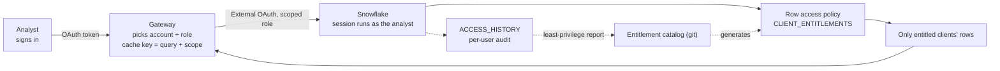

# Worked Example: A Client-Isolated Reporting App

Pair-programmed by SE Community + Cortex Code

An internal reporting app lets analysts see results only for the clients they are assigned to. This example takes it from a shared-identity gateway to Snowflake-enforced isolation: an entitlement catalog, the identities and roles it compiles to, a row access policy, entitlement-scoped cache keys, and a least-privilege report. Read this alongside the [guide](README.md); its review and expiry dates apply to this companion too.

**Audience:** Platform, security, and app engineers whose internal apps, portals, or agents query Snowflake through a shared gateway

> **No support provided.** Reference only; validate before production use.

## Start Here

Follow the request from a signed-in analyst to the rows Snowflake returns. The SQL and YAML blocks are complete specifications for the fictional objects below, not an account setup script. All names and data are synthetic.



**The division of responsibility:** The catalog defines who may see which client. Snowflake enforces it on every query. The gateway only routes and caches. The checks below run in SQLite against the fixture to prove the logic; they do not prove Snowflake deployment.

## 1. Start with the question, not the features

*"As an analyst, show me revenue for my clients."*

Three analysts are assigned clients; a fourth has none yet. One client has no assigned analyst. A correct system must:

- Return each analyst's clients and nothing else
- Return zero rows, not an error or another client's data, to the analyst with no assignments
- Never serve one analyst a cached result computed for a different set of clients
- Surface grants nobody has used in 90 days

## 2. Define the source contract

| Object | Grain | Notes |
| --- | --- | --- |
| `PRINCIPALS` | One row per person, app, or agent | `KIND` is `HUMAN`, `SERVICE`, or `AGENT` |
| `ENTITLEMENTS` | One row per principal and client | Generated from the catalog; the row access policy reads this as `CLIENT_ENTITLEMENTS` |
| `CLIENT_RESULTS` | One row per client and month | Protected by the row access policy on `CLIENT_ID` |
| `GRANTS` | One row per role, object, and grant date | Stand-in for `GRANTS_TO_ROLES` |
| `ACCESS_LOG` | One row per role, object, and access | Stand-in for `ACCESS_HISTORY` joined to `QUERY_HISTORY` |

Dates are ISO strings. The least-privilege report is computed as of `2026-11-19`.

### Synthetic fixture

<!-- fixture: PRINCIPALS -->
```csv
PRINCIPAL,KIND
ANALYST_A,HUMAN
ANALYST_B,HUMAN
ANALYST_C,HUMAN
ANALYST_D,HUMAN
```

<!-- fixture: ENTITLEMENTS -->
```csv
PRINCIPAL,CLIENT_ID
ANALYST_A,C1
ANALYST_A,C2
ANALYST_B,C2
ANALYST_D,C2
```

<!-- fixture: CLIENT_RESULTS -->
```csv
RESULT_ID,CLIENT_ID,MONTH,REVENUE
1,C1,2026-09,100
2,C1,2026-10,150
3,C2,2026-09,200
4,C2,2026-10,50
5,C3,2026-10,300
```

<!-- fixture: GRANTS -->
```csv
ROLE_NAME,OBJECT_NAME,GRANTED_ON
R_SALES_R,SALES.ORDERS,2026-01-10
R_SALES_R,SALES.REFUNDS,2026-01-10
R_SALES_R,SALES.RETURNS,2026-01-10
R_FIN_RW,FIN.LEDGER,2026-03-01
R_FIN_RW,FIN.BUDGET,2026-11-01
```

<!-- fixture: ACCESS_LOG -->
```csv
ROLE_NAME,OBJECT_NAME,ACCESSED_AT
R_SALES_R,SALES.ORDERS,2026-06-01
R_SALES_R,SALES.ORDERS,2026-11-10
R_SALES_R,SALES.REFUNDS,2026-08-21
R_SALES_R,SALES.RETURNS,2026-08-22
```

Edge cases built in: `ANALYST_C` has no entitlements; `C3` has no entitled analyst; `ANALYST_B` and `ANALYST_D` have identical scope; `SALES.REFUNDS` was last used exactly 90 days before the report date and `SALES.RETURNS` 89 days before; `FIN.LEDGER` was never used, while `FIN.BUDGET` was never used but was granted only 18 days ago.

## 3. Configure the entitlement catalog and Snowflake objects

### The entitlement catalog

The catalog is the single source of truth. Access requests change this file through a pull request; tooling generates the mapping table, roles, and grants from it.

<!-- example: entitlement-catalog -->
```yaml
version: 1
data_classes:
  - name: restricted_client
    description: Contractually separated client data. Row-level isolation by client is required.
  - name: general
    description: Reference data readable by any internal principal with schema access.
schemas:
  - account: reporting_account
    database: REPORTING_DB
    schema: REPORTING
    data_class: restricted_client
    isolation_column: CLIENT_ID
teams:
  - name: delivery_team
    access:
      - {schema: REPORTING_DB.REPORTING, level: R}
principals:
  - {name: ANALYST_A, kind: human, teams: [delivery_team], clients: [C1, C2]}
  - {name: ANALYST_B, kind: human, teams: [delivery_team], clients: [C2]}
  - {name: ANALYST_C, kind: human, teams: [delivery_team], clients: []}
  - {name: ANALYST_D, kind: human, teams: [delivery_team], clients: [C2]}
  - name: SVC_REPORTING_APP
    kind: service
    auth: workload_identity
    access:
      - {schema: REPORTING_DB.REPORTING, level: R}
    clients: []
cache:
  key: sha256(normalized_query + sorted_client_scope)
  ttl_seconds: {restricted_client: 300, general: 3600}
```

The service principal has schema access but no clients. It can run queries, but the row access policy returns none of the restricted rows unless it acts on behalf of a person through that person's identity.

### Identities

<!-- example: identities -->
```sql
-- People: custom External OAuth from your authorization server
CREATE SECURITY INTEGRATION ext_oauth_people
  TYPE = EXTERNAL_OAUTH ENABLED = TRUE EXTERNAL_OAUTH_TYPE = CUSTOM
  EXTERNAL_OAUTH_ISSUER = '<authorization_server_url>'
  EXTERNAL_OAUTH_JWS_KEYS_URL = '<jwks_url>'
  EXTERNAL_OAUTH_AUDIENCE_LIST = ('<audience>')
  EXTERNAL_OAUTH_TOKEN_USER_MAPPING_CLAIM = 'sub'
  EXTERNAL_OAUTH_SNOWFLAKE_USER_MAPPING_ATTRIBUTE = 'LOGIN_NAME'
  EXTERNAL_OAUTH_SCOPE_MAPPING_ATTRIBUTE = 'scp'
  EXTERNAL_OAUTH_ANY_ROLE_MODE = 'DISABLE';

-- Agents: a separate integration so sessions are flagged as agentic
CREATE SECURITY INTEGRATION ext_oauth_agents
  TYPE = EXTERNAL_OAUTH ENABLED = TRUE EXTERNAL_OAUTH_TYPE = CUSTOM
  EXTERNAL_OAUTH_ISSUER = '<authorization_server_url>'
  EXTERNAL_OAUTH_JWS_KEYS_URL = '<jwks_url>'
  EXTERNAL_OAUTH_AUDIENCE_LIST = ('<agent_audience>')
  EXTERNAL_OAUTH_TOKEN_USER_MAPPING_CLAIM = 'sub'
  EXTERNAL_OAUTH_SNOWFLAKE_USER_MAPPING_ATTRIBUTE = 'LOGIN_NAME'
  IS_AGENTIC = TRUE;

-- Apps: one service user per app, workload identity, no stored secret
CREATE USER svc_reporting_app TYPE = SERVICE
  WORKLOAD_IDENTITY = (TYPE = AWS ARN = 'arn:aws:iam::<account>:role/<app_role>')
  DEFAULT_ROLE = reporting_app_role;
```

### Access roles

<!-- example: access-roles -->
```sql
CREATE DATABASE ROLE reporting_db.reporting_r;
GRANT USAGE ON SCHEMA reporting_db.reporting TO DATABASE ROLE reporting_db.reporting_r;
GRANT SELECT ON ALL TABLES IN SCHEMA reporting_db.reporting TO DATABASE ROLE reporting_db.reporting_r;
GRANT SELECT ON FUTURE TABLES IN SCHEMA reporting_db.reporting TO DATABASE ROLE reporting_db.reporting_r;

CREATE ROLE delivery_team;
GRANT USAGE ON DATABASE reporting_db TO ROLE delivery_team;
GRANT DATABASE ROLE reporting_db.reporting_r TO ROLE delivery_team;
```

### Client isolation policy

<!-- example: row-access-policy -->
```sql
CREATE ROW ACCESS POLICY governance.policies.client_isolation
AS (row_client_id VARCHAR) RETURNS BOOLEAN ->
  EXISTS (
    SELECT 1 FROM governance.entitlements.client_entitlements e
    WHERE e.principal = CURRENT_USER()
      AND e.client_id = row_client_id
  );

ALTER TABLE reporting_db.reporting.client_results
  ADD ROW ACCESS POLICY governance.policies.client_isolation ON (client_id);
```

The argument is named `row_client_id`, not `client_id`, so that it cannot be confused with the mapping table's column. For production, Snowflake recommends replacing the mapping-table subquery with a memoizable function.

### Least-privilege report

<!-- example: least-privilege-report -->
```sql
WITH grants AS (
  SELECT grantee_name AS role_name,
         table_catalog || '.' || table_schema || '.' || name AS object_name,
         created_on AS granted_on
  FROM SNOWFLAKE.ACCOUNT_USAGE.GRANTS_TO_ROLES
  WHERE granted_on = 'TABLE' AND privilege = 'SELECT' AND deleted_on IS NULL
), usage AS (
  SELECT q.role_name, obj.value:"objectName"::STRING AS object_name,
         MAX(a.query_start_time) AS last_accessed
  FROM SNOWFLAKE.ACCOUNT_USAGE.ACCESS_HISTORY a
  JOIN SNOWFLAKE.ACCOUNT_USAGE.QUERY_HISTORY q ON q.query_id = a.query_id,
       LATERAL FLATTEN(input => a.base_objects_accessed) obj
  WHERE a.query_start_time >= DATEADD(day, -365, CURRENT_TIMESTAMP())
  GROUP BY 1, 2
)
SELECT g.role_name, g.object_name, u.last_accessed
FROM grants g
LEFT JOIN usage u ON u.role_name = g.role_name AND u.object_name = g.object_name
WHERE DATEDIFF(day, COALESCE(u.last_accessed, g.granted_on), CURRENT_TIMESTAMP()) >= 90
ORDER BY 1, 2;
```

`QUERY_HISTORY.role_name` is the session's primary role. A grant exercised only through role inheritance or a secondary role does not match by name, so treat the output as revocation *candidates* to review, never as an automatic revoke list.

## 4. Define what a correct answer looks like

Each check below is the portable equivalent of the Snowflake behavior, run against the fixture.

### Each principal sees only entitled clients

Equivalent to every analyst running `SELECT COUNT(*), SUM(revenue) FROM client_results` under the row access policy.

<!-- check: visible_rows_per_principal -->
```sql
SELECT p.PRINCIPAL,
       COUNT(r.RESULT_ID) AS VISIBLE_ROWS,
       COALESCE(SUM(r.REVENUE), 0) AS VISIBLE_REVENUE
FROM PRINCIPALS p
LEFT JOIN ENTITLEMENTS e ON e.PRINCIPAL = p.PRINCIPAL
LEFT JOIN CLIENT_RESULTS r ON r.CLIENT_ID = e.CLIENT_ID
GROUP BY p.PRINCIPAL
ORDER BY p.PRINCIPAL
```

<!-- expect: visible_rows_per_principal -->
```csv
PRINCIPAL,VISIBLE_ROWS,VISIBLE_REVENUE
ANALYST_A,4,500
ANALYST_B,2,250
ANALYST_C,0,0
ANALYST_D,2,250
```

`ANALYST_C` gets zero rows, and nobody sees `C3`. Total revenue across all clients is 800, but no single analyst sees it all.

### Cache keys never cross entitlement scopes

The gateway keys each cache entry on the normalized query plus the caller's sorted client scope.

<!-- check: cache_scope_per_principal -->
```sql
SELECT p.PRINCIPAL,
       COALESCE((SELECT GROUP_CONCAT(s.CLIENT_ID, '|')
                 FROM (SELECT e.CLIENT_ID FROM ENTITLEMENTS e
                       WHERE e.PRINCIPAL = p.PRINCIPAL
                       ORDER BY e.CLIENT_ID) s), 'NONE') AS ENTITLEMENT_SCOPE
FROM PRINCIPALS p
ORDER BY p.PRINCIPAL
```

<!-- expect: cache_scope_per_principal -->
```csv
PRINCIPAL,ENTITLEMENT_SCOPE
ANALYST_A,C1|C2
ANALYST_B,C2
ANALYST_C,NONE
ANALYST_D,C2
```

`ANALYST_B` and `ANALYST_D` share a scope, so they may safely share a cached result. `ANALYST_A` never receives their entry, and they never receive hers.

### Unused grants become revocation candidates

A grant is a candidate when 90 or more days have passed since its last use, or since it was granted if it has never been used.

<!-- check: revocation_candidates -->
```sql
SELECT g.ROLE_NAME, g.OBJECT_NAME,
       COALESCE(MAX(a.ACCESSED_AT), 'NEVER') AS LAST_ACCESSED
FROM GRANTS g
LEFT JOIN ACCESS_LOG a
  ON a.ROLE_NAME = g.ROLE_NAME AND a.OBJECT_NAME = g.OBJECT_NAME
GROUP BY g.ROLE_NAME, g.OBJECT_NAME, g.GRANTED_ON
HAVING julianday('2026-11-19') - julianday(COALESCE(MAX(a.ACCESSED_AT), g.GRANTED_ON)) >= 90
ORDER BY g.ROLE_NAME, g.OBJECT_NAME
```

<!-- expect: revocation_candidates -->
```csv
ROLE_NAME,OBJECT_NAME,LAST_ACCESSED
R_FIN_RW,FIN.LEDGER,NEVER
R_SALES_R,SALES.REFUNDS,2026-08-21
```

`SALES.REFUNDS` (exactly 90 days) is included and `SALES.RETURNS` (89 days) is not. `FIN.BUDGET` is excluded because it was granted only 18 days ago. `SALES.ORDERS` counts its latest access, not its earliest.

### Acceptance cases

| Question | Expected behavior |
| --- | --- |
| ANALYST_A: "Revenue for my clients?" | 500 across C1 and C2 |
| ANALYST_C: "Revenue for my clients?" | Says no clients are assigned; does not say "no data" |
| ANALYST_B asks the same question ANALYST_A just asked | Cache miss (different scope); 250 for C2 |
| ANALYST_D asks the same question ANALYST_B just asked | Cache hit allowed (same scope); 250 |
| Agent session asks for all clients' revenue | Runs as the agent's mapped user; flagged agentic in `QUERY_HISTORY.agent_type`; sees only that user's clients |
| Service user queries `CLIENT_RESULTS` directly | Zero restricted rows; it has no client entitlements |

### Keep kinds of evidence separate

Local fixture tests prove the arithmetic, the boundary rules, and that the catalog parses. They do not prove Snowflake deployment or end-to-end enforcement. For that, run the acceptance cases in a non-production account with real users of each kind. Use [`POLICY_CONTEXT`](https://docs.snowflake.com/en/user-guide/security-row-using) to simulate the policy for a given user, and confirm each query in `ACCESS_HISTORY` under the expected user name.

## 5. Why this is enough configuration

One catalog, one policy, one role pair, and three identity types cover the whole pattern. Masking policies, organization users, and Snowflake-native hosting are deliberately left out of the fixture: they extend the same idea (the session carries the real caller) without changing the checks. Add them once the enforcement path above is proven.

## External References

| Topic | Source |
| --- | --- |
| [Custom External OAuth authorization server](https://docs.snowflake.com/en/user-guide/oauth-ext-custom) | docs.snowflake.com |
| [Workload identity federation](https://docs.snowflake.com/en/user-guide/workload-identity-federation) | docs.snowflake.com |
| [Agent identity](https://docs.snowflake.com/en/user-guide/agent-identity) | docs.snowflake.com |
| [GRANT privilege](https://docs.snowflake.com/en/sql-reference/sql/grant-privilege) | docs.snowflake.com |
| [Using row access policies](https://docs.snowflake.com/en/user-guide/security-row-using) | docs.snowflake.com |
| [ACCESS_HISTORY](https://docs.snowflake.com/en/sql-reference/account-usage/access_history) | docs.snowflake.com |
| [GRANTS_TO_ROLES](https://docs.snowflake.com/en/sql-reference/account-usage/grants_to_roles) | docs.snowflake.com |
